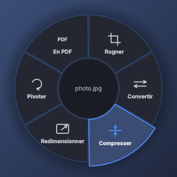

# Cerclic

Une roue d'actions rapides sur tes fichiers, sous Windows 10 et 11 : rogner,
signer, compresser, convertir, raccourcir une vidéo… en un geste, sans ouvrir
d'autre application.



## Ouvrir la roue

- **Ton raccourci clavier** (Ctrl + Alt + Espace au départ) sur les fichiers
  sélectionnés dans l'Explorateur ou sur le Bureau. Tu choisis la combinaison
  que tu veux dans Cerclic.
- **Clic droit sur un fichier, puis « Cerclic »** (tout en haut du menu), dans
  l'Explorateur, sur le Bureau et dans les fenêtres Ouvrir/Enregistrer de
  toutes les applications, avec un ou plusieurs fichiers (jusqu'à 100 d'un
  coup). Sous Windows 11, l'entrée est dans « Afficher d'autres options » ;
  Cerclic peut remettre le menu complet en un clic.
- **Glisse des fichiers sur l'icône Cerclic** du Bureau.

La roue s'ouvre sous ta souris, avec un aperçu du fichier au centre. Passe sur
une action pour voir ce qu'elle fait, clique pour la lancer, clique au centre
pour revenir, Échap pour fermer. Les touches 1 à 9 et les flèches marchent
aussi.

## Ce que Cerclic sait faire

Tout se passe dans de petites fenêtres qui s'ouvrent là où était la roue, à la
taille de ton image. Ton fichier d'origine n'est jamais modifié : chaque
résultat est un nouveau fichier à côté, par exemple `photo (compressed).jpg`,
et « Annuler » sur la carte de résultat le supprime.

**Images** (JPG, PNG, WEBP, HEIC d'iPhone, AVIF, GIF, BMP, TIFF) : rogner
(formats 1:1, 4:5, 16:9…), pivoter ou retourner en miroir, redimensionner,
compresser, convertir en JPG, PNG ou WEBP, copier pour coller où tu veux,
réunir en un PDF, assembler plusieurs images en une (côte à côte, en colonne,
en grille), anonymiser (retirer la position GPS, le modèle du téléphone, la
date… sans aucune perte de qualité pour les JPG et PNG).

**PDF** : signer (tu dessines ta signature une fois, puis tu la poses à la
souris), rogner, compresser, fusionner, organiser les pages (trier, tourner,
supprimer, extraire), convertir en Word, en images ou en texte, diviser,
pivoter, filigrane, numéros de page, protéger par mot de passe, déverrouiller.

**Vidéo** : raccourcir (garder un passage, avec l'image sous les yeux),
compresser, convertir en MP4 lisible partout, en GIF, extraire le son, couper
le son, pivoter une vidéo filmée de travers.

**Son** (MP3, M4A, WAV, notes vocales WhatsApp OPUS/OGG, FLAC…) : raccourcir,
convertir en MP3, compresser.

Une barre montre l'avancement, « Arrêter » interrompt proprement.

## Installer

Télécharge `CerclicSetup-x.y.z.exe` et lance-le : pas de droits
administrateur, pas de Python à installer, rien à configurer. Cerclic démarre
avec Windows et se range près de l'horloge.

Windows peut afficher « Windows a protégé votre ordinateur » car l'application
n'est pas encore signée numériquement : clique sur « Informations
complémentaires », puis « Exécuter quand même ».

Une version portable (`Cerclic-x.y.z-portable.zip`) est aussi fournie :
décompresse-la où tu veux et double-clique sur `Cerclic.exe`.

## Réglages

Ouvre Cerclic depuis son icône (Bureau ou menu Démarrer), ou clique sur son
icône près de l'horloge : raccourci clavier (clique sur « Modifier » puis
appuie sur ta combinaison), entrée du clic droit, menu complet de Windows 11,
signature, qualité, démarrage avec Windows. Tout s'applique tout de suite.

En cas de souci, le journal `cerclic.log` se trouve dans `%APPDATA%\Cerclic`.

## Désinstaller

Paramètres Windows, Applications, Cerclic, Désinstaller. Tout ce que Cerclic a
ajouté (entrée du clic droit, démarrage automatique) est retiré.

## Pour les développeurs

```
python -m venv .venv
.venv\Scripts\activate
pip install -r requirements-dev.txt
pytest                      # 190+ tests : actions, interface, communication
pythonw run_cerclic.py      # lancer depuis le code
```

Construire l'application : le workflow GitHub (`.github/workflows/build.yml`)
fabrique l'exécutable, l'installateur et la version portable sur Windows ;
`scripts/build_windows.sh` fait la même chose depuis Linux avec Wine. Détails
dans `docs/ARCHITECTURE.md`.
